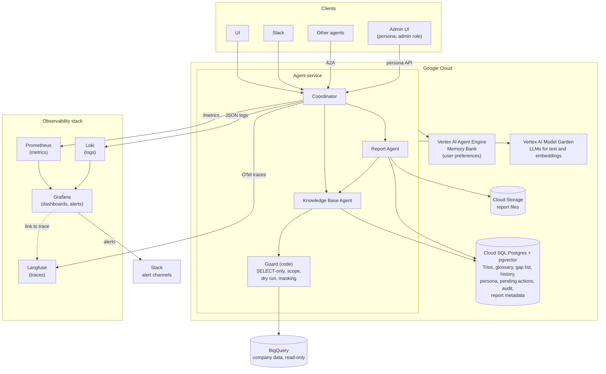

# Overview

## Table of contents

- [Overview](#overview)
- [Architecture](#architecture)
  - [Architecture overview](#architecture-overview)
  - [The agents](#the-agents)
  - [What the model decides and what code enforces](#what-the-model-decides-and-what-code-enforces)
- [Hybrid intelligence](#hybrid-intelligence)
  - [The Golden Bucket](#the-golden-bucket)
  - [Business glossary](#business-glossary)
  - [At question time](#at-question-time)
  - [Knowledge Base Agent contract](#knowledge-base-agent-contract)
- [Safety and PII masking](#safety-and-pii-masking)
  - [2.1 PII classification](#21-pii-classification)
  - [2.2 Prompt rules](#22-prompt-rules)
  - [2.3 Columns (PII flagging)](#23-columns-pii-flagging)
  - [2.4 Rows (data scope)](#24-rows-data-scope)
  - [2.5 Re-identification through aggregates](#25-re-identification-through-aggregates)
  - [2.6 Dry run and query cost](#26-dry-run-and-query-cost)
  - [2.7 Output masker](#27-output-masker)
  - [Safety layers](#safety-layers)
- [High-Stakes Oversight (Destructive Ops)](#high-stakes-oversight-destructive-ops)
  - [Reports and ownership](#reports-and-ownership)
    - [How reports are made](#how-reports-are-made)
  - [Flow](#flow)
- [Continuous improvement: the learning loop](#continuous-improvement-the-learning-loop)
  - [Framework and memory service selection](#framework-and-memory-service-selection)
  - [User level: preferences](#user-level-preferences)
  - [System level](#system-level)
- [Resilience and graceful error handling](#resilience-and-graceful-error-handling)
  - [Self-correction](#self-correction)
  - [Keeping costs under control](#keeping-costs-under-control)
  - [Dependency failures](#dependency-failures)
  - [What the user sees](#what-the-user-sees)
- [Observability](#observability)
  - [Metrics: when](#metrics-when)
  - [Logs: what happened](#logs-what-happened)
  - [Traces: why](#traces-why)
- [Agility: persona management](#agility-persona-management)
- [Quality Assurance](#quality-assurance)
  - [What is measured](#what-is-measured)
  - [LLM judge and manual review](#llm-judge-and-manual-review)
  - [Review environment and feedback loop](#review-environment-and-feedback-loop)
  - [Release gate](#release-gate)
  - [UX and production monitoring](#ux-and-production-monitoring)

# Architecture



## Architecture overview

Executives chat with the assistant in a web UI or in Slack, and other agents can call it over A2A. A **Coordinator** agent holds the conversation and delegates to two specialist subagents: the **Knowledge Base Agent**, which looks up how analysts answered similar questions (the Golden Bucket) and runs SQL, and the **Report Agent**, which writes reports. All agents run in one service (Python, FastAPI and Strands) that keeps nothing in its own memory between requests, and use Gemini on Vertex AI. Everything that has to be remembered is stored outside the service: the data stays in BigQuery, the application data (chat history, Trios, glossary, persona, reports) lives in Cloud SQL for PostgreSQL, report files in Cloud Storage, and user preferences in Vertex AI Agent Engine Memory Bank.

The infrastructure is deliberately small: one agent service, one database, managed models. The design effort goes into the agents: what each one sees, what it may do, and what code enforces around it.

The guiding principle: **the model is never trusted to enforce a rule.** Privacy, data access, destructive actions and cost limits are enforced by code. Prompts only make the model behave well enough that these limits rarely have to step in.

## The agents

The agents are connected with the Strands **agents as tools** pattern. Each one has its own model, prompt, tools and step budget, and each subagent is created fresh for every call, so its context holds only what that one task needs.

| Agent | Model | Receives | Returns | Tools |
| --- | --- | --- | --- | --- |
| **Coordinator** | Flash-Lite | Conversation, preferences, persona | The answer to the user | `ask_knowledge_base`, `write_report`, `list_reports`, `read_report`, `propose_deletion`, `current_time` |
| **Knowledge Base Agent** | Flash | A standalone question, schema, allowlist | Findings (answer, small table, final SQL, caveats) | `search_trios`, `lookup_glossary`, `run_sql`, `current_time` |
| **Report Agent** | Flash | Findings from the conversation, persona, preferences | Report (title, summary, insights, action items, caveats) | `ask_knowledge_base`, `current_time` |

`run_sql` is the only route to BigQuery, and it always goes through the guard.

Why this split:

- **Raw rows stay out of the conversation.** Query results only exist inside a short-lived Knowledge Base Agent call. The Coordinator and the Report Agent get compact findings, so their context stays small, cheap and free of row-level data.
- **Retrieval and SQL in one agent.** The agent that finds a similar Trio is the one that writes and runs the SQL, so the Trio doesn't have to be passed between agents. That means fewer model calls, lower latency and less to go wrong.
- **The right model for each job.** Routing and conversation run on the cheapest model. SQL and reports need more reasoning and use a stronger one.
- **Each agent sees only what it needs.** The Knowledge Base Agent never sees the persona or the user's identity. Only the agents that write answers receive the persona.
- **Easy to extend.** A new capability is one more tool or subagent on the Coordinator.

## What the model decides and what code enforces

| The model decides | Code enforces |
| --- | --- |
| How to interpret the question | Who the user is, their role and data scope (from the signed-in session) |
| Which tools to call and in what order | Which tables and columns exist for it (allowlist, blocked columns) |
| The SQL it writes | The guard: SELECT-only, scope filter and row cap added to that SQL, cost check (dry run) |
| How to explain the results | Masking of query results and redaction of the final answer |
| Which reports to propose for deletion | What is actually deleted, and only after the user's confirmation |
| How many steps and queries it uses | Step, query and cost budgets per question |

No tool has a `user_id` or scope parameter, so the model has nothing to forge.

# Hybrid intelligence

## The Golden Bucket

The bucket holds human-made **Trios**: Question → SQL → Analyst Report. The schema tells the agent what data exists, and the [glossary](#business-glossary) what business terms mean. The Trios show **how a type of question is answered**: how analysts translated a similar question into SQL (tables, joins, filters), and how they structured the report (comparisons, insights, action items).

**Trios are examples, never answers.** The agent adapts them to the new question, and the adapted SQL goes through the SQL guard and the user's scope like any other query.

### One Trio

```yaml
id: trio_0142
question: "Why are users in state X underspending compared to state Y?"
intent_summary: "Compare average order value and order frequency between two regions"
sql: "SELECT ..."
report_ref: trio_reports/0142          # stored separately, loaded only when needed
sample_rows: [...]                     # optional, a few rows showing the result shape
tables_used: [orders, order_items, users]
theme: regional-comparison             # exactly one, from a fixed list
tags: [spend, order-value, frequency]  # any number, free
author: analytics-team
status: approved                       # approved | deprecated
schema_version: 3
created_at: 2026-03-02
last_validated_at: 2026-09-30
```

Each Trio has exactly one **theme** from a fixed list (regional comparison, product performance, time-based metrics, customer behavior, schema questions) and any number of free **tags**. Tags help search find the right Trio. Themes show coverage: analysts count Trios and gap-list misses per theme to see which kinds of questions the bucket can't answer yet, and the held-out eval set covers every theme.

### Storage

Cloud SQL PostgreSQL with pgvector **is** the Golden Bucket the agent uses. `trios` holds everything needed for search, including an `embedding` column built from _question + intent summary_. The report sits in `trio_reports`, so vector search never loads it. How Trios get there is described below.

### Bucket refresh

- **Start.** Analysts begin with the reports that already exist: the historical Trios are imported and go through the same checks and review as any candidate. If there are none, analysts write about 30 Trios themselves, covering the most common question themes and focusing on the tricky ones, where the agent would most likely go wrong without an example (ambiguous terms, multi-step analyses, unusual joins).
- **Candidates come from production**, in two kinds:
    - **Answered well without a good match:** no match or a weak match, but a good outcome (thumbs up, saved report, no retries, user didn't rephrase). The session already has a working answer, so it becomes a draft Trio. Questions already covered by a high match are skipped.
    - **Answered badly:** thumbs down, the agent gave up, or the user kept rephrasing. These go to the expert queue as open questions. The agent's SQL is not reused, because it was wrong; the expert writes the correct SQL and report. If a strong Trio match was used and the answer was still bad, that Trio is flagged for review too, since it may be outdated or misleading.
- **A candidate is only a draft.** From the session we get the question, the SQL (before the scope rewrite) and the tables. The intent summary and tags are drafted by an LLM. The report is the agent's draft, not an analyst's.
- **Automated checks before a human sees it:** SQL guard passes, dry run and execution OK, result not empty, PII scan on the text, near-duplicate check against existing Trios.
- **Analyst completes and approves:** reviews the summary and tags, generalizes the SQL, writes or fixes the report. Then the Trio is written to Postgres, embedded and indexed.
- **Never auto-promote.** One bad or malicious session could poison what everyone gets.
- **Schema changes.** A nightly job re-runs the SQL of Trios with an older `schema_version`. Trios that fail are deprecated and go back to the analyst queue.
- **Models.** Drafting the intent summary and tags runs in the background, where speed doesn't matter and volume is low (a few candidates a day). So it uses the stronger model, because a better draft saves analyst time. Trios and incoming questions are embedded with the same embedding model.

## Business glossary

The schema says what the columns are, but not what the business means by words like "churn" or "underspending". Different people, and the model, can read the same question differently and all produce valid but different numbers. The glossary fixes one definition per term for this company, so every user gets the same answer to the same question.

| Term | Synonyms | Definition (in our case) | SQL hint |
| --- | --- | --- | --- |
| Revenue | sales, turnover | Sum of `sale_price` of order items that were not cancelled or returned | `order_items.status NOT IN ('Cancelled', 'Returned')` |
| Active customer | | A customer with at least one order in the last 90 days | `orders.created_at >= CURRENT_DATE - 90` |
| Churned customer | lost customer | Active in the previous 90 days, with no order in the last 90 days | Compare two 90-day windows per `user_id` |
| Average order value | AOV, basket size | Revenue divided by the number of distinct orders | `SUM(sale_price) / COUNT(DISTINCT order_id)` |
| Underspending | | A group whose average order value is more than 20% below the company average for the same period | Compare group AOV with overall AOV |
| Return rate | | Returned order items divided by all order items, by count | `COUNTIF(status = 'Returned') / COUNT(*)` |

- **Storage.** A `glossary` table in Postgres (`term`, `synonyms[]`, `definition`, `sql_hint`, `updated_by`, `updated_at`), versioned like the persona.
- **Who edits it.** Analysts, in the admin pages. No developer and no deployment needed. Every change passes the eval suite before it is activated, because a new definition changes the numbers.
- **Undefined terms.** If a question uses a business term that isn't in the glossary, the agent states the definition it used ("I counted churn as no order in the last 90 days"). The term is logged to the gap list, so analysts can define it.
- **Why it matters.** Many repeated mistakes come from unclear terms, and one definition fixes them for every user at once. It's the cheapest way for the system to improve.

## At question time

The Coordinator calls the **Knowledge Base Agent**, which prepares context before it writes any SQL:

1. **Rewrite** the question into a standalone one using the conversation. "And for state Y?" alone retrieves nothing useful.
2. **Glossary lookup.** The Knowledge Base Agent matches terms and synonyms in the question against the glossary.
3. **Split** multi-step questions ("why did churn spike?") into sub-questions and search for each.
4. **Search:** vector similarity on question + intent summary, combined with tag and keyword match (hybrid search, merged with reciprocal rank fusion). Only `approved` Trios with the current `schema_version`.
5. **Threshold.** If nothing is similar enough, nothing is injected and the agent works from the schema alone. The miss is logged to the **gap list**, which shows analysts which topics are missing (important for later analysis and bucket upgrades).
6. **Top 2-3** (optionally re-ranked with a cheap model call). A loosely related match is still passed, flagged as such, so the agent knows it may be useful but must not be followed.

## Knowledge Base Agent contract

The Knowledge Base Agent finds similar Trios, writes and runs the SQL through the guard, and returns compact findings to the Coordinator or the Report Agent. It never answers the user directly. What it sees is limited on purpose.

**Failure.** If the bucket is unavailable, the Trio search returns "no match" and the Knowledge Base Agent answers from the schema alone. The answer may be less refined, but the user still gets one. A `golden_bucket_unavailable` event is counted, so the outage shows up in metrics.

# Safety and PII masking

Three separate concerns, each with its own mechanism:

| Concept | Question it answers | Example | Enforced by |
| --- | --- | --- | --- |
| **PII rules** | Which columns may _nobody_ see? | `email`, `first_name`, blocked for everyone | PII-free views, SQL guard, result masker, output scan |
| **Data scope** | Which _rows_ may this user analyze? | Only brands MG and Nike, or category Y | Scope rewrite in the SQL guard |
| **Permission level** (role in the classic sense) | Which _actions_ may this user take? | Viewer, maintainer, admin: can they delete others' reports, edit the persona, etc. | Session + Postgres row-level security + admin pages |

Identity, role and scope come from the authenticated session (IAP identity → `users` → `scope_groups`). **No tool has a `user_id` or scope parameter**, so the model has nothing to forge.

## 2.1 PII classification

| Table | Never queryable | Pseudonymized | Demographic (groups only) | Allowed |
| --- | --- | --- | --- | --- |
| `users` | `first_name`, `last_name`, `email`, `street_address`, `postal_code`, `latitude`, `longitude`, `user_geom` | `id` | `age`, `gender`, `city`, `created_at` | `state`, `country`, `traffic_source` |
| `orders` | | `user_id` | `gender` | the rest |
| `order_items` | | `user_id` | | the rest |
| `products` | | | | all (`cost` is business-sensitive, not PII) |

State and country stay allowed because questions like "state X vs state Y" need them. Exact location (postal code, coordinates) does not.

**Demographic columns** are not personal on their own, but together they describe a person: _"Customer A7F3, F, 15, United States"_ is one specific (and here underage) customer, pseudonym or not. So they may describe **groups** but never appear on a per-customer row.

## 2.2 Prompt rules

- This is the **first line of defense**.
- A paragraph in the prompt prohibits the agent from querying certain columns.
- It doesn't guarantee the agent's behavior, but it's nice to have.
- If the model knows which columns are off limits, it writes fewer queries the guard has to reject, so you get fewer retries.
- The model is only told about allowed columns (schema from the allowlist), so it rarely writes queries that need rejecting.

## 2.3 Columns (PII flagging)

**SQL guard:** a Python module built on `sqlglot`, which parses each query into a syntax tree so rules can be checked in code. It runs before any query is executed and:

- rejects anything that is not a single `SELECT` statement
- rejects any column or table that is not on the allowlist, anywhere in the query (select list, `WHERE`, `JOIN`, subqueries, CTEs), so PII cannot leak indirectly
- blocks anything unclassified by default

In the prototype, the allowlist covers only the four tables (`users`, `orders`, `order_items`, `products`) and only the columns we classified as safe.

**Implementation.** In both production and prototype, a column or table flagged as PII can never be fetched, regardless of who the user is. The only difference is how the flagging is done.

| | Production | Prototype |
| --- | --- | --- |
| **Flagging** | Sensitive Data Protection scans the BigQuery tables and flags likely PII columns, and a data steward confirms the classification | We write the classification ourselves as a config (`config/data_policy.yaml`) |
| **Enforcement** | BigQuery natively: policy tags deny flagged columns to the agent's identity, and one PII-free view per table in the `analytics` dataset is the only thing that identity can read. The guard's allowlist is generated from the same classification. | Allowlist config + sqlglot guard (SELECT only, one statement, allowed tables and columns only) |
| **Why** | PII is unreachable for every user, whatever their permission level, whatever the code does. The guard stays as defense in depth and gives the model readable error messages. | The public dataset is not ours, so policy tags and views can't be applied. The prototype mirrors production in code. |
| **Extra layers** | SQL guard, output masker and final-answer scan remain (defense in depth) | Dry run + `maximum_bytes_billed` validate the query and cap its cost. Output masker before the LLM (drops disallowed columns, pseudonymizes IDs). Final regex scan redacts emails and phone numbers from answers and saved reports, and logs a security event on any hit. |

## 2.4 Rows (data scope)

- Identity and scope come from the authenticated session, **never from the LLM or the prompt**.
- **Prototype:** a config file mapping each user to the brands or categories they may analyze. The mapping is done manually.
- **Production:** identity provider's claims plus a scope table.
- **How it's enforced:** the guard rewrites every table reference into a pre-filtered subquery, after parsing but before the dry run.
- The model never sees or writes this filter, so it can't be talked out of it, and a repair attempt can't drop it.
- It is deterministic code, covered by tests (CTEs, subqueries, joins, a CTE named like a real table).
- The guard also gives a useful message: Ana asking about Adidas hears "outside your access", not "zero sales".

**Production pros**

- BigQuery enforces the filter itself (row access policies or authorized views), so even a bug in the guard can't bypass it.
- That is a stronger guarantee than application code.

**Production cons**

- Row access policies attach to identities (users or groups), but the agent will probably run as one service account for everyone.
- We need either per-scope service accounts or groups that the agent impersonates per request, or per-scope authorized views the agent picks between.
- That is real design and setup work that the prototype skips.
- It's also why many production systems keep the application-level rewrite as well, as defense in depth, just like the PII layers.

## 2.5 Re-identification through aggregates

Two cases, and our required capabilities create a tension here.

- **"Top customers, total spend"** needs per-person rows.
    - Allow it, but with pseudonyms: a keyed hash of the user ID, `HMAC-SHA256(key, user_id)`, gives labels like "Customer A7F3…".
    - The key is in Secret Manager, so labels can't be reversed by hashing guessed IDs, and they stay stable, so a follow-up like "tell me more about Customer A7F3" still works.
    - Names never exist in the model's context.
- **Small-group aggregates** ("average age of women in a small town who bought product Y") can pinpoint one person.
    - Use a minimum group size, k = 5.
    - To make it enforceable on arbitrary SQL, the guard appends a hidden `COUNT(DISTINCT user_id) AS _n` column to queries that use who customers are (customer attributes or demographics).
    - The masker drops any group where `_n < k` and says so in the answer.
    - Plain sales figures (revenue of a brand, units of a product) are never hidden, because they say nothing about a person.

## 2.6 Dry run and query cost

BigQuery has a dry run feature that validates a query. Before running, every query gets a dry run: it validates the SQL and returns the bytes it would scan, without cost. A query over the limit is rejected with a hint ("add a date filter"), and every real job also sets `maximum_bytes_billed` (1 GB) and a 60 s timeout.

## 2.7 Output masker

Two maskers: one before and one after the LLM call.

- **Before (result masker):** checks for columns that shouldn't be there before the result is given to the LLM. Drops blocked columns, pseudonymizes customer IDs, hides groups with fewer than 5 customers.
- **After (output scan):** a hook that runs before the agent returns the answer to the user. It scans the final response for anything potentially sensitive and replaces it with `[REDACTED]`.
    - Regex for emails and phone numbers.
    - Applies to every answer, trace and saved report.
    - On a hit we emit a `pii_redacted` security event.

## Safety layers

| | Layer | What it does | Prototype |
| --- | --- | --- | --- |
| 1 | **Intent gate** | A cheap, fast model call (Flash-Lite) classifies each message as analysis, schema question, report management or out of scope. Out-of-scope messages get a polite refusal and never reach the agent. | Prompt rules only |
| 2 | **Prompt rules** | First line of defense. Tells the agent which columns are off limits, and that user text, tool results and database values (product names are free text) are data, never instructions. Fewer rejected queries, fewer retries. | Same |
| 3 | **Schema allowlist** | The model is only told about allowed columns, so it rarely writes queries that need rejecting. | Same |
| 4 | **BigQuery permissions** | Policy tags and PII-free views: the agent's identity can read only the `analytics` dataset, and the raw tables are out of its reach. | Not possible on a public dataset, so the guard's allowlist mirrors it |
| 5 | **SQL guard** (sqlglot) | Exactly one `SELECT`. Allowed tables and columns only, anywhere in the query. Customer IDs may not be transformed. Demographics only for groups. Row cap. **This is the layer that actually holds.** | Same |
| 6 | **Scope rewrite** | Every table reference becomes a pre-filtered subquery built from the session's scope, so the user only sees their rows. | Same |
| 7 | **Dry run + cost cap** | Validates the SQL and returns the bytes it would scan. Over the limit is rejected. Real jobs set `maximum_bytes_billed` (1 GB) and a 60 s timeout. | Same |
| 8 | **Result masker** (before the LLM) | Drops blocked columns, pseudonymizes customer IDs, hides groups with fewer than 5 customers. | Same |
| 9 | **Output scan** (after the LLM) | Redacts emails and phone numbers from every answer, trace and saved report, and emits a `pii_redacted` security event. | Same |
| 10 | **Limits** | Message length, steps per message, queries per question (retry budget), bytes per query, per-user rate limit, daily cost budget. | All except rate limit and cost budget |

# High-Stakes Oversight (Destructive Ops)

**Principle:** the model can only **propose**. It has no delete tool, can't confirm, and never sees the user's "yes". Code deletes exactly what the user was shown.

## Reports and ownership

### How reports are made

A report is written only when the user asks for one. The Coordinator calls the `write_report` tool with a short request ("Q1 sales review with action items for Q2"), and the Report Agent takes over. It starts from the findings already gathered in the conversation: every Knowledge Base Agent answer is kept as compact, already-masked findings, so a report on what was just discussed costs no new queries. For anything still missing, the Report Agent asks the Knowledge Base Agent focused, standalone questions, at most a fixed number per report. The Knowledge Base Agent handles them like any other question: it searches the Golden Bucket by embeddings and tags for similar past examples, uses their hints on tables and topics to write the SQL faster and map it to the right tables, and runs the query through the same guard, scope and masking as any other. The Bucket only helps with SQL. The structure and tone of the report come from the Report Agent's own instructions and the persona. The Report Agent never sees raw rows.

**Code, not the model, saves the report.** Before saving, the output scan redacts any emails or phone numbers. The metadata (owner from the session, thread ID, title, summary, tags, scope, created date, full-text index and embedding) is stored in Postgres, and the full report is stored as a file in Cloud Storage. The user gets the title, summary and a link. From then on, the report can be listed, read, searched and deleted only by its owner (see [Flow](#flow)).

**Prototype:** the same flow. Findings are kept in a per-thread notebook in memory, the persona comes from a YAML file, and reports are saved to SQLite with a Markdown file on disk.

- Each report contains an `owner_id` and associated metadata, including the thread ID, title, summary, tags, scope, creation date, full-text index (or a reference to the report's storage location in Google Cloud Storage, depending on the report's size), and embedding.
- Reports are private. Only the owner can see or delete them. Every query has `WHERE owner_id = :session_user`, and Postgres row-level security enforces the same rule.
- Users can delete by report ID, by conversation ("all reports from this conversation"), by term ("mentioning Client X") or a combination. This is a hard delete.

## Flow

1. User asks "Delete all reports from this conversation".
2. **Proposal.** Agent calls `propose_deletion({thread: "current"})`. Other filters: `{term: "Client X"}`, `{ids: [...]}` or a combination. There is no `user_id` parameter.
3. **Dry run.** Code adds the owner from the session and runs only a `SELECT`. Matching is keyword-based, never embeddings.
4. **Pending state.** The exact IDs are stored in `pending_actions` with a 5-minute expiry. Only one pending deletion per user; a new proposal cancels the old one.
5. **What the agent sees:** only "N reports awaiting the user's confirmation. They are NOT deleted yet."
6. **Confirmation, outside the model.** The UI shows a card with the count, titles, dates and a matching snippet. For more than 5 reports, the user types the number to confirm.
7. **Execution.** Only if the pending action exists, is unexpired and belongs to this user. The stored IDs are deleted and the filter is **not** re-run, so the set can't change between what the user saw and what is deleted.
8. **Outcome to the agent.** The result is passed as an app note with the next message, so the agent can talk about it but never claim a deletion that didn't happen.

# Continuous improvement: the learning loop

Two levels. **User level** changes how the agent answers one person. **System level** changes how it works for everyone.

## Framework and memory service selection

I chose **Strands Agents** as the agent framework because I am most familiar with it. Strands is an open-source, model-driven agent framework developed by AWS. It integrates closely with AWS services, particularly Amazon Bedrock and Amazon Bedrock AgentCore.

Since the system's data is stored in Google Cloud, I would prefer to use Google services for memory management where appropriate. Using the same cloud provider for data storage and memory management could simplify integration, authentication, access control and ongoing maintenance.

Strands is not limited to AWS services, however. It can be integrated with Google services through APIs, custom tools and, where necessary, custom memory-store adapters. Some additional implementation may be required because Strands' native integrations are oriented toward AWS services.

For the production implementation, I would consider migrating from Strands to Google's **Agent Development Kit (ADK)**, as it would provide closer alignment with the Google Cloud ecosystem. This could simplify integration with Google services and reduce the complexity of maintaining custom integrations. The migration would depend on whether ADK meets the system's requirements and whether the benefits justify the additional migration effort.

## User level: preferences

**Chosen: a managed memory service, Vertex AI Agent Engine Memory Bank (Google).** 
The application sends relevant user conversation data to Memory Bank, which extracts and consolidates durable memories for that user. In subsequent sessions, the application retrieves the relevant memories and resolves them into the application's predefined preference schema.

| Preference | Values | Used by |
| --- | --- | --- |
| `format` | table, bullets, prose | Coordinator and Report Agent |
| `depth` | summary, standard, detailed | Coordinator and Report Agent |
| `charts` | yes, no | Coordinator and Report Agent |

**What Memory Bank does**

1. **What we send.** After each turn, the application sends the user's message to Memory Bank (`memories.generate`). The extraction only sees what we put in the request, which is why we decide what to send: **the user's messages only**, with guardrails before anything is sent, and never query results or the agent's data-heavy answers.
2. **Extraction.** Memory Bank extracts presentation preferences (format, depth, charts) from the message. Only information that fits a configured memory topic is persisted, so we configure a custom topic limited to presentation preferences (optionally with few-shot examples) instead of the default managed topics.
3. **Consolidation.** Memories are grouped by scope (`{"user_id": ...}`, taken from the authenticated session). Memory Bank checks that a new memory is not duplicative or contradictory before merging it with the existing ones in the same scope.
4. **Retrieval.** When a new thread starts, the application retrieves the user's memories (`memories.retrieve`, by scope) and passes them to the answer/report step only. SQL steps never see them.
5. **Visible and resettable.** "What do you remember about me?" lists the user's memories (list or retrieve), and the user can change or reset them (delete or purge).

**Trade-off.** Less code to write and run than building the storage and extraction ourselves, but we depend on the service for how extraction and consolidation behave. The rule that doesn't depend on the provider: the service only sees what we send it, so user messages only, never query results.

## System level

The agent isn't retrained. It improves through what surrounds it:

```
Signals                      thumbs up/down + reason, retries, rephrasing, abandonment
   |
   v
Weekly failure review        grouped by an LLM, reviewed by an analyst
   |
   v
Fix                          new or corrected Trio, glossary entry, prompt change
   |
   v
Failure becomes an eval case --> Release gate
```

Trio candidates and the gap list come from the Golden Bucket.

1. **Feedback buttons** (thumbs up/down with an optional reason) are the main signal. Without them the system only guesses from retries, rephrasing and abandonment.
2. **Golden Bucket growth.** Questions answered well without a match become Trio candidates. Questions without a match go to the gap list.
3. **Failure review.** Failed answers are grouped (a small LLM summarizes and clusters them to save analyst time) and repeated problems are fixed by an analyst.
4. **Business glossary** (churn, underspending, active customer). Many repeated mistakes come from unclear terms, and one definition fixes them for everyone. It's the cheapest system-level improvement.
5. **Every confirmed failure becomes an eval case**, which makes "improves itself" measurable and catches regressions.
6. **Every change is versioned** (Trios, glossary, prompts, persona) and passes the release gate, so it can be rolled back.

# Resilience and graceful error handling

The system must detect failures, try to self-correct before giving up, never crash the UI, never inflate costs, and survive third-party outages.

Failures fall into two families that need opposite treatment. Every error type is classified in code by family, by whether it is retryable, and by who handles it (model, code or user).

| Family | Examples | Response |
| --- | --- | --- |
| **The agent produced something wrong** | SQL syntax error, unknown or blocked column, wrong filter, empty result | Give the model another chance **with better information** |
| **A dependency failed** | Gemini rate limit or outage, BigQuery unavailable, Golden Bucket down, network error | **Retry, fall back or degrade in code.** Re-prompting the model wouldn't help. |

## Self-correction

- Guard rejections and BigQuery errors go back to the Knowledge Base Agent as text it can act on, together with the relevant schema.
- **Two budgets per question:** at most **3 failed queries** (first try + 2 repairs) and **5 queries** in total. Only failures count toward the first, so a question that needs several queries isn't cut short, while a model stuck on a broken query stops early.
- **The same query twice is refused**, so the model can't loop.
- **Empty results are not automatically errors**, because zero rows can be the right answer. The model may check a filter value once (is the brand spelled right, is the date range valid). Otherwise it reports the empty result honestly: "no sales of brand X in Wyoming last week".
- **Self-correction can never loosen access.** Scope is applied by code on every attempt, so dropping a filter to "get rows back" still returns only the user's rows.
- **Giving up is a designed state.** The user gets what was tried, why it failed and a suggestion to narrow the question. The conversation continues.

**Note:** The retry numbers are configuration, not constants. If queries turn out to be complex (because of the database design) and the agent needs more tries, we can raise them after seeing how the agent behaves in production.

## Keeping costs under control

Failures must not turn into cost spikes, so everything that can spend money is capped per question:

- **One turn budget** covers model calls, queries and steps. Repairs, retries and fallbacks all count against it, so backoff + fallback + repair can't multiply.
- **Per-user rate limit and daily cap**, so one user or a runaway loop can't drain the quota.
- **Expensive queries are rejected before they run** (BigQuery dry run), with a hint to add a filter.
- When the budget is reached, the turn stops with a clear message instead of continuing silently.

## Dependency failures

- **Retry only what is safe to retry.** Reads can be retried. Deletion and report generation are never retried blindly.
- **One retry layer only** (no retries stacked inside retries), with exponential backoff and jitter, honoring `Retry-After` when the provider sends it.
- **Timeouts on every external call**, plus an overall deadline per turn, so the UI never waits forever.
- **Fallback and circuit breaker:** if the primary Gemini tier keeps failing, switch to the other Flash tier, and skip the primary for 60 s after repeated failures.
- **Optional parts fail alone.** If charts, email or web search break, the analysis continues without them.
- **The guard fails closed.** If the guard or scope check itself errors, the query is rejected, never skipped.

## What the user sees

Every failure is converted into a **typed error** (code, user-facing message, trace ID, retryable flag). The frontend never receives a raw exception or stack trace. If a response is streaming and fails midway, the partial text is kept and marked as incomplete, with an error message after it.

### Error handling and fallbacks

| Dependency | If it fails | The user sees |
| --- | --- | --- |
| **Gemini** | Retries with backoff, then fallback to the other Flash tier (circuit breaker). If all models are down, the turn stops. | Usually nothing, or "The AI service is busy, please try again in a minute" |
| **BigQuery** | Retry once, then the agent stops. | "The data service is temporarily unavailable" |
| **Postgres** | Answer without saving history. Reports and deletion refuse. | "Saving is temporarily unavailable" |
| **Golden Bucket, optional tools, persona** | Each fails alone: continue without examples or the tool, or use the last good persona. | A normal answer, possibly less refined |
| **Anything else** (step or cost limit, unexpected error) | The turn stops and is logged with the trace ID. | A clear message with a reference |

# Observability

Three layers: **metrics** answer "_when_ is the agent failing", **traces** answer "_why_", and **structured logs** fill the gaps between them: they are the raw record of every event, and the source for extra dashboards.

**Grafana is the single place we look.** It reads metrics from Prometheus and logs from Loki, hosts the dashboards and the alerts, and links out to Langfuse for the full trace of a single turn.

## Metrics: when

A Strands hook runs on every agent cycle and records metrics in one format, so a new metric or a new agent needs no change to the agent logic. The service exposes them on a **`/metrics` endpoint**, **Prometheus scrapes** that endpoint on a fixed interval, and **Grafana dashboards** are built on top of Prometheus.

| Group | Metrics |
| --- | --- |
| Agent | Tool errors, end-to-end and per-step latency, **cycle count** (a rising count is the earliest sign of a loop), input / output / cached tokens, tokens per model, cost per agent |
| SQL | Syntax error rate, empty-result rate, repairs per question, **self-correction success rate**, bytes scanned, budget exhaustion |
| Golden Bucket | Hit rate, best-match similarity, gap-list growth |
| Safety | Intent gate refusals, `pii_redacted`, out-of-scope rejections, prompt-injection detections |
| Deletion | Proposed, executed, cancelled, expired |
| Dependencies | Gemini 429 / 5xx rate, fallback usage, circuit breaker state, BigQuery errors |
| Quality | Thumbs up/down ratio, rephrasing rate, sampled judge scores |
| Cost | Cost per turn, daily total. Per-user cost lives in Langfuse, because user IDs as Prometheus labels would explode cardinality. |

Not all of these metrics come from the Strands metrics object. The rest (SQL repairs, empty-result rate, Golden Bucket hits, guard rejections, `pii_redacted`, deletion states, feedback, cost) are emitted by our own code as custom metrics or logged events. Any of them can also be derived from the structured logs in Loki, which is useful for metrics we didn't instrument up front.

### Alerts

Grafana alert rules send notifications to dedicated channels in Slack (or another tool), with separate channels for cost, answer quality, and security events like scope violations or `pii_redacted`. Typical triggers are self-correction success below baseline, spikes in SQL errors or empty results, Gemini fallback becoming active, latency over target, and cost over budget. Alerts can be reviewed manually by an analyst, or passed to an agent that pulls the related logs and traces and suggests a likely cause.

## Logs: what happened

The service writes **structured logs (one JSON object per line)** that are shipped to **Loki** and queried from Grafana.

- **Fixed fields on every line:** timestamp, level, event name, `trace_id`, `turn_id`, `thread_id`, `user_id`, agent, plus event-specific fields such as tool, duration, error code, repair number, tokens and cost.
- **Loki labels are few and stable** (service, level, agent). High-cardinality values like `user_email` and `turn_id` stay inside the log line, not in the labels.
- **Logs help with more than debugging.** Because every event has the same fields, Grafana can turn log queries into dashboards without any new code in the agent: repairs per day, give-up reasons, slowest tools, most common error codes, usage per persona. A question we didn't plan a metric for can often be answered from the logs after the fact.
- **Good structure also makes AI-assisted debugging possible.** The logs of one turn can be pulled by `turn_id` and given to an LLM to explain what went wrong, and error logs from a time window can be grouped and summarized to find patterns. This only works well if the logs are consistent and have clear event names, which is why the schema is fixed.

## Traces: why

Traces show a single turn end to end (every model call, tool call and query, including timing, token usage and cost). They help explain why an answer was slow, expensive or incorrect.

**Langfuse** is our LLM observability and evaluation platform. It collects OpenTelemetry traces from Strands and supports debugging, cost monitoring and answer-quality evaluation.

- **One trace per turn:** tagged with `user_id`, `thread_id` and persona version.
- **One span per step:** records model calls, tool calls, SQL queries, guardrail decisions and confirmation steps, including relevant inputs, outputs, errors and timing.
- **Debugging:** Grafana highlights trends and alerts; engineers inspect logs and Langfuse traces to identify the root cause. The trace ID serves as the user's error reference.
- **Quality monitoring:** user feedback and evaluator scores help detect silent failures (confident but incorrect answers) and are attached to traces in Langfuse.

# Agility: persona management

**Persona management.** The system prompt has two parts. **Core rules** (safety, PII, data scope, instruction hierarchy) live in code, are versioned with the application, and can't be edited at runtime. The **persona** (tone and style instructions plus metadata) is stored as versioned configuration in **PostgreSQL**. Each version is an immutable row (version number, content, metadata, status, author, timestamp), and the active version is a single pointer. The persona always ranks below the core rules, so it can change style but never permissions or data scope. It is loaded into the Coordinator and the Report Agent (the agents that write the final answer or report) when a thread starts, and cached in the service so a short Postgres outage doesn't block new threads. The SQL steps never receive it.

Admins edit it in an admin UI restricted to the admin role (enforced in the backend, not only in the UI): save a draft, preview it on a sample question, publish. Publishing validates the content. Rollback means activating a previous version, and a thread keeps the version it started with. Every create, publish and activation is written to an audit table with who and when, and the persona version is recorded in every trace and log line. If the active persona is missing or invalid, the service falls back to the last good version and raises a warning.

# Quality Assurance

## What is measured

A report can fail at several levels, so each one is measured separately. A single overall score would hide where it went wrong.

| Layer | Question | Measurement |
| --- | --- | --- |
| **Intent** | Was the question understood correctly? | LLM judge using a fixed rubric |
| **SQL** | Are tables, joins, filters and time periods correct? | Execute generated and expert SQL and compare result sets, not SQL text |
| **Numbers** | Are the reported numbers correct? | Extract numbers and entities from the answer and verify them against query results |
| **Faithfulness** | Does the explanation accurately reflect the data? | LLM judge and checks against query results |
| **Usefulness** | Are insights and action items specific and data-supported? | LLM judge compared with expert reports |
| **Safety** | Were privacy and scope restrictions respected? | Pass/fail; any PII leak or scope violation blocks release |

## LLM judge and manual review

Quality is evaluated by both an **LLM judge and human reviewers**: the judge provides scalable, consistent checks, while people validate its reliability and catch errors it may miss. The judge uses a fixed rubric and a different model family from the generator, and is periodically calibrated against analyst ratings.

## Review environment and feedback loop

A **staging environment** lets reviewers and selected users test the agent before release.

- Each answer has **thumbs-up / thumbs-down** feedback and an optional note. Ratings are attached to the corresponding Langfuse trace for investigation.
- On a schedule, an LLM groups negative feedback by likely cause (wrong table, misunderstood term, missing metric, tone) and identifies positive examples worth preserving.
- The result is a set of **improvement candidates**: new or corrected Trios for the Golden Bucket, glossary updates, and prompt or persona fixes.
- **A human approves every candidate** before adoption. Nothing enters the Golden Bucket automatically. Retrieval examples remain separate from a protected, held-out evaluation set used to measure generalization and prevent test-data leakage.

## Release gate

Every change to a prompt, model, tool, Trio, glossary term or persona passes through the following process:

1. **CI evaluation:** run unit tests, regression tests, quality evaluations and safety checks against a fixed evaluation set.
2. **Release criteria:** block the change if it violates safety requirements or falls below defined accuracy and faithfulness thresholds. Store evaluation results in Langfuse.
3. **Canary rollout:** deploy to a small share of traffic (5%) and compare quality, errors, latency and cost against the production baseline.
4. **Promote or roll back:** expand to 100% if metrics remain within acceptable limits; otherwise, roll back.

## UX and production monitoring

- **Before release:** test latency (time to first progress and total response time), preference adherence, readability for non-technical users, error messages, and confirmation-flow friction, using scripted scenarios and reviews with a small group of executives.
- **After release:** monitor thumbs-up/down ratings, rephrasing, abandonment, task completion (whether a report was saved), latency, errors and cost. Compare versions on dashboards and investigate significant regressions. Treat behavioral signals as indicators for investigation, not definitive proof of poor quality.
